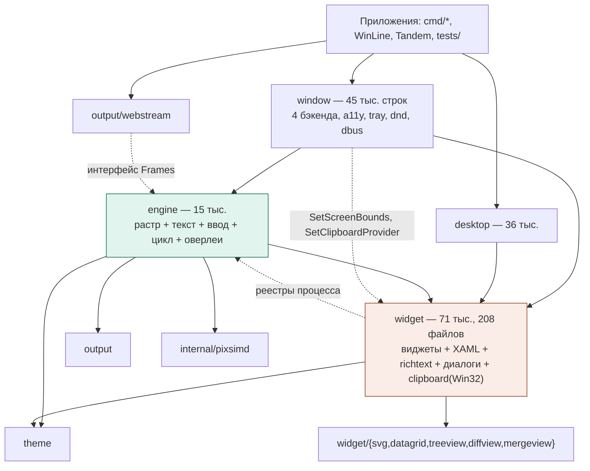
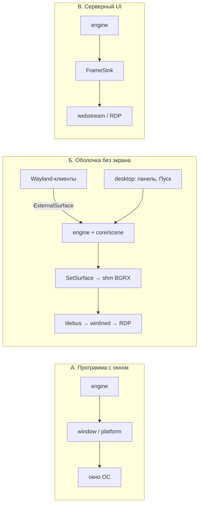
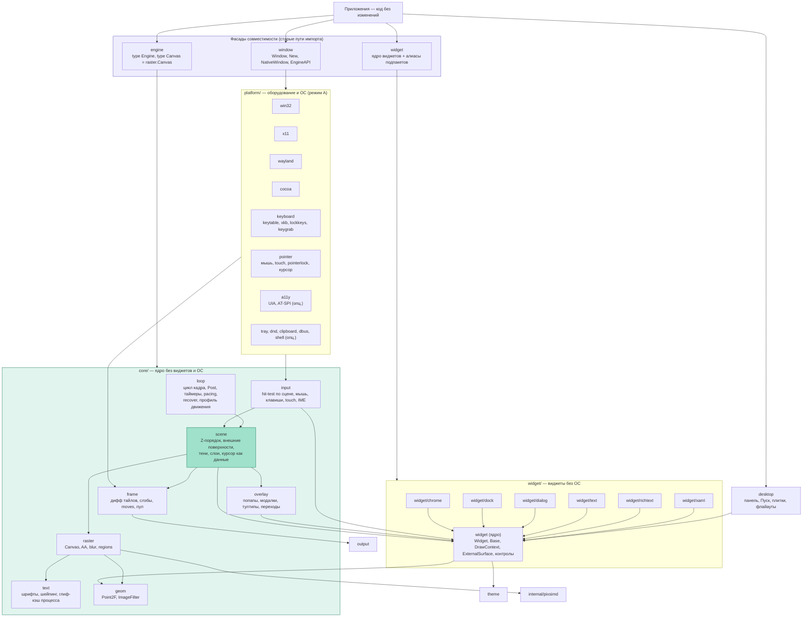

# Обзор архитектуры движка и предложение по переразбиению

Версия 2 от 2026-10-26. Ветка `develop`, HEAD `dbb721c` (после v3.44.0).

Что изменилось против версии 1: движок рассматривается не только как
библиотека для самостоятельных программ, а как основа WinLine (оболочка
рабочего стола по RDP) и Tandem (RDP-клиент). Учтены их отчёты о проблемах,
добавлены тени окон, переходы меню и живые плитки как функции движка,
и вторая ступень улучшений внутри ядра (модель рендера).

Главное ограничение не изменилось: существующие программы принимают новый
движок без правок или с минимальными.

---

## 0. Итог на одну страницу

1. **Переразбиение пакетов** (слои `core` / `widget` / `platform`, старые
   пути импорта остаются фасадами) даёт порядок, тонкие сборки и
   устойчивость к сбоям, но почти не меняет скорость горячего пути. Он
   уже оптимизирован.
2. **Самый большой выигрыш для WinLine** лежит не в пакетах, а в том, что
   сегодня сессия WinLine компонует окна чужих программ **снаружи** движка
   в три прохода с попиксельной перестановкой каналов. Движок должен стать
   единственным компоновщиком сцены: `core/scene` с внешними поверхностями
   в общем Z-порядке, тенями, классификацией видео и выводом прямо в
   shm-буфер BGRX. Это снимает две полные копии кадра на каждый кадр
   сессии и ручную синхронизацию Z-порядка для ввода.
3. **Тени окон, переходы меню, живые плитки** становятся свойствами сцены и
   темы, а не кодом каждого виджета: тень как 9-slice-кэш узла сцены,
   переход оверлея как композиция уже нарисованного попапа, плитка как
   источник состояний с кэшированным растром. Все три подчиняются
   профилю движения, который WinLine выставляет по `performanceFlags`
   клиента RDP.
4. **Вторая ступень внутри ядра** (список команд рисования, тайловая
   растеризация в пуле, дифф по хэшу команд, один буфер кадра, общий
   глиф-кэш на процесс) даёт полный кадр в разы быстрее, дифф почти
   бесплатно и вдвое меньше памяти под кадр. Решение принимать по
   прототипу, не по оценке.
5. **Совместимость**: результат работы — версия 4.0.0 с путём модуля
   `github.com/oops1/headless-gui/v4`. Единственная обязательная правка у
   потребителей — замена `/v3` на `/v4` в импортах и `go.mod`; остальной
   код работает через фасады без изменений. Единственное наблюдаемое
   изменение поведения — паника в виджете больше не роняет процесс;
   прежнее поведение возвращается одной строкой.

---

## 1. Текущая архитектура

### 1.1. Пакеты

Строки — без тестов. Экспорты — по `go doc`.

| Пакет | Строк | Файлов | Экспортов | Что внутри |
|---|---:|---:|---:|---|
| `engine` | 15 028 | 60 | 196 | растеризатор `Canvas`, шрифты и шейпинг, цикл кадра, диспетчеризация ввода, попапы, модалки, тултипы, таймеры, `Post` |
| `widget` | 70 704 | 208 | 1 684 | базовые виджеты, XAML и биндинг (7,1 тыс.), RichText/HTML (5,9 тыс.), диалоги (3,6 тыс.), докинг (3,7 тыс.), оконная рамка (4,0 тыс.), буфер обмена с Win32-syscall (2,8 тыс.), темы, анимации, локализация |
| `window` | 44 641 | ~190 | 171 | бэкенды Win32 (88 КБ), X11 (87 КБ), Wayland (104 КБ), Cocoa (27 КБ); UIA (103 КБ) и AT-SPI (58 КБ); трей, DnD, буфер обмена, D-Bus, IME, lock-клавиши, хосты попапов и модалок |
| `desktop` | 36 376 | ~100 | 785 | панель задач, «Пуск», флайауты, предпросмотр окон (потребитель — WinLine) |
| `theme` | 5 361 | 38 | 119 | токены, профили, менеджер, анимации |
| `output` | 282 | 5 | 15 | `Frame`, `DirtyTile`, `Region`, `MoveRegion`, `Slab` |
| `output/webstream`, `output/pdf`, `printing` | ~2 600 | | | потребители кадров |
| `internal/pixsimd` | | 9 | | SIMD-сравнение тайлов и размытие (amd64) |

Бинарники в корне: `showcase.exe` 14,0 МБ, `webshowcase.exe` 19,6 МБ.

### 1.2. Явный и скрытый граф зависимостей

Сплошные стрелки — `import`. Пунктирные — скрытые связи через глобальные
реестры процесса: движок регистрируется в `widget.RegisterUINotifier`,
`RegisterTextMeasurer`, `RegisterMoveSink`, `svg.RegisterTextRasterizer`,
`BindAnimationLoop`; окно — в `widget.SetScreenBounds`, `SetPopupWorkArea`,
`SetClipboardProvider`. Одна палитра `win10` и `SetLanguage`/`SetLocale` на
процесс.

### 1.3. Горячий путь

Насос ОС или сессия → `inputQueue` → `Engine.Post` → горутина кадра:
`runPosted` → `StepAnimations` → `renderFrame` под `frameMu` (damage → фон →
`root.Draw` с пропуском поддеревьев → оверлеи → модалки → попапы) →
`diffTiles` (`GOMAXPROCS` горутин, если ≥ 64 тайлов) → `Frame{Tiles,
Regions, Moves}` → `FrameSink` или канал глубины 8.

Что уже хорошо и переделывать не нужно: headless-контракт, рендер по
запросу и список damage, пропуск поддеревьев и вычитание перекрытого, слэб
тайлов и переработка кадров, `Regions`/`Moves`, внешний темп, очередь
`Post`, SIMD, `SetSurface`, `SetPixelFormat`, `widget.ExternalSurface`,
границы размеров холста.

Измеренное (README, Core Ultra 7 265K): hover ~45 мкс, частичный кадр ~38
мкс, полный кадр 1280×800 ~2,2 мс, дифф Full-HD без изменений ~110 мкс,
`ExternalSurface` 4K при 10 % изменений ~0,95 мс.

### 1.4. Что мешает внутри движка

| № | Проблема | Где | Последствие |
|---|---|---|---|
| П1 | Ядро не выделено. 28 файлов `engine` не упоминают `widget`, но лежат рядом с диспетчером ввода (`events.go`, 55 КБ), попапами и циклом. Растр зависит от `widget` только ради `Point2F` и `ImageFilter`. | `engine/` | растеризатор нельзя взять без виджетов; правки ввода пересобирают растр |
| П2 | `widget` — монолит: 71 тыс. строк, 1 684 экспорта; XAML с reflect, HTML-парсер, диалоги, докинг и буфер обмена с Win32-вызовами в одном пакете. | `widget/` | каждое приложение компилирует всё; правка одного виджета пересобирает 71 тыс. строк |
| П3 | Глобальные реестры процесса: инвалидации рассылаются всем движкам, измеритель текста — «последнего созданного», палитра одна. | `widget/invalidate.go`, `measure.go`, `theme.go` | лишняя работа при двух и более движках (hosted-диалог, Tandem с окном на каждый монитор); WinLine запрещал два рабочих стола в процессе |
| П4 | `window` — монолит: под Linux компилируются оба бэкенда, любое окно тянет UIA, AT-SPI, трей, DnD, D-Bus. | `window/` | размер и время сборки |
| П5 | Ни одного `recover` в `engine` и `window`. Паника в `Draw` одного виджета валит процесс. Для сервера рабочего стола это отказ всех сессий. | `engine/engine.go` | низкая устойчивость |
| П6 | `GOMAXPROCS` горутин создаются на каждый кадр в `diffTiles` и `blit_opaque`. | `engine/canvas.go:1692` | 37 аллокаций на полный дифф Full-HD; по времени — в пределах шума (измерено в 1.3: пробуждение воркера стоит как запуск горутины) |
| П7 | У каждого попапа свой `Canvas` с парой буферов. | `engine/popuphost.go` | 2×w×h×4 байт на попап |
| П8 | Один масштаб на холст и физический размер = логический × масштаб. | `engine/scale.go` | WinLine: «масштаб интерфейса 100–200 % недоступен, движок отдаёт кадр не того размера» |

---

## 2. Движок как основа: три режима встраивания

Архитектура обязана держать их равноправными, потому что один и тот же
код виджетов и тем работает во всех трёх.

| Режим | Кто | Что подключено | Чего быть не должно |
|---|---|---|---|
| **А. Самостоятельная программа с окном ОС** | Tandem, showcase, Блокнот и Проводник WinLine как отдельные процессы | `engine` + `window` + бэкенд ОС, системный курсор, буфер обмена ОС, a11y | ничего лишнего, но сборка тянет всё `window` |
| **Б. Оболочка рабочего стола без экрана** | `winline-session`: композитор Wayland + shell | `engine` + `desktop` + сток кадра (`FrameSink`/`SetSurface`) + внешние поверхности (окна Wayland-клиентов) | `window` и `platform` не нужны вовсе; курсор отдаётся клиенту RDP, а не рисуется |
| **В. Серверный интерфейс для удалённого клиента** | greeter WinLine, `webstream`, формы входа | `engine` + сток; кадры кодируются снаружи | окна ОС |

Следствия для архитектуры:

- **Сток — главный выход, канал — обёртка.** WinLine уже перешёл на
  `SetFrameSink`: канал глубины 8 терял кадры, и «окна оставались стоять
  на старых местах». Канал остаётся для тестов и простых программ, но
  реализуется поверх стока с политикой слияния пропущенных кадров.
- **Режим Б не должен линковать `platform`.** Сегодня `cmd/winline-session`
  импортирует только `engine`, `widget`, `desktop`, `theme` — это надо
  закрепить: `core` и `widget` не импортируют ничего платформенного.
- **Несколько движков в одном процессе — норма**, а не исключение: Tandem
  создаёт по движку на монитор, WinLine — hosted-диалоги и второй стол.
  Поэтому адресная инвалидация и общий глиф-кэш.
- **Старый `rdp/internal/rdp-ui`** (форма входа прокси на движке v0 от
  марта 2026, курсор рисуется в кадр красной точкой) в требования не
  включён: его роли перешли к WinLine и Tandem. Если он жив, мигрирует
  через фасады без правок разметки.

---

## 3. Что говорят потребители

### 3.1. WinLine (`github.com/oops1/WinLine`, движок v3.43.2)

64 файла `pkg/shell` и шесть приложений (settings, explorer, calculator,
notepad, terminal, tandem) живут на движке. `ENGINE_ISSUES.md` — 18 записей,
все закрыты. Из `RENDER_PIPELINE_STUDY.md` §9 движок сделал пункты 3, 4, 5,
7, 8, 11 (damage списком, пропуск поддеревьев, классификация, BGRX,
`SetSurface`, `MoveRegion`). Что осталось — ниже, и это уже архитектура, а
не отдельные задачи.

| № | Что в WinLine сегодня | Где | Что должно стать в движке |
|---|---|---|---|
| W1 | **Композиция чужих окон снаружи движка.** `handleFrame` → `blitTile` (RGBA→BGRX попиксельно, хотя `SetPixelFormat(BGRX)` есть с v3.15) → слой `shell` → `recompose`: `copyShell` → `compositor.CompositeAll` (окна клиентов поверх) → `restoreOverlays` (панель и флайауты снова поверх) → второй проход `TakeStale` → `master` → `flush`. `kinds.forget` стирает классификацию под окнами. `overlayRects` и `FocusedWindowBounds` вручную сообщают компоновщику, куда не отдавать клики. | `cmd/winline-session/compose.go`, `main.go:909` | Движок — единственный компоновщик: `core/scene` с внешними поверхностями в общем Z-порядке (§4.4). Сессия отдаёт движку shm-буфер через `SetSurface` (BGRX) и буферы клиентов через `ExternalSurface`; `compose.go` исчезает |
| W2 | **Видео определяется эвристикой** (12 коммитов/с, доля площади, гистерезис 5 с), чтобы отдавать область в H.264. | `pkg/compositor/video.go` | `ExternalSurface` знает частоту `Swap` и подсказку клиента (`wp_content_type_v1`): движок ставит `RegionVideo` сам, а порог — токен |
| W3 | **Пропуск поддеревьев выключен**: «сцена не соответствует контракту `Draw`» (терминал делал раскладку в `Draw`; есть ещё нарушения). | `pkg/shell/desktop.go:395` | Режим диагностики контракта: `Engine.SetDrawContractCheck(true)` ловит `Invalidate`/`SetBounds`/`Animate` внутри `Draw` и называет виджет. Без этого culling у главного потребителя так и останется выключенным |
| W4 | **Масштаб интерфейса 100–200 % недоступен**: «движок отдаёт кадр не того размера». | `CHANGELOG.md:754`, `SETTINGS_ACCEPTANCE.md:149` | Разделить физический размер поверхности и логический размер сцены: `SetScaleWithin(k)` держит физический кадр W×H, логическая сцена — W/k × H/k (§4.5) |
| W5 | **Канал кадров терял кадры**, пока сессия кодировала; перешли на синхронный `FrameSink`. | `pkg/shell/desktop.go:2041` | Сток — основной путь; канал — поверх стока со слиянием |
| W6 | **Два рабочих стола в процессе были запрещены** (гонка `StepAnimations`, исправлена). | `ANALYSIS-2026-09-02.md` | Адресная инвалидация и анимации, привязанные к движку, а не к процессу |
| W7 | **`performanceFlags` клиента** применяются только для обоев (`PERF_DISABLE_WALLPAPER`). | `ARCHITECTURE.md`, tilebus `Hello.flags` | `Engine.SetMotionProfile` и токены эффектов: анимации меню, тени, Mica, полное перетаскивание окна — отключаемы одним профилем |
| W8 | **Мониторы**: один холст на весь стол, панель на основном; разный DPI мониторов — ограничение. | `docs/MULTIMON_PLAN.md` | Остаётся ограничением: один масштаб на холст. Честно описать |
| W9 | **Композитор WinLine присылал устаревший `configure`, движок принял любой размер** у окна с фиксированным размером. | `rdpclient/docs/ENGINE_BUG_WAYLAND_CONFIGURE_SIZE.md` | Валидация в `platform/wayland`: configure сверяется с `pinSize` |
| W10 | Мелкие контракты: `Window.OnClose` занят оболочкой; клик по заголовку снимает фокус (`focus.set(nil)`); повторный клик по шеврону переоткрывает меню вместо закрытия. | `docs/TAB_WINDOW_PLAN.md` | Поправимо в `core/input` и `core/overlay`; в архитектуру не влияет |

### 3.2. Tandem (`D:\Projects\GoLang\rdpclient`, v1.5.x; копия в `winline/pkg/apps/tandem`)

Правило проекта: «движок — как есть; чего не умеет, просим у команды
движка, не обходим хаками». Задачи E1–E15 из `ENGINE_TASKS.md` сделаны,
кроме E8 (окна RemoteApp без рамки с внешним управлением) и E15 (macOS,
отложено). Цели ROADMAP 0.6: 4K AVC444 60 к/с ≤ 50 % ядра, p95 от PDU до
экрана ≤ 20 мс.

| № | Отчёт | Что показывает | Что учесть |
|---|---|---|---|
| T1 | `ENGINE_BUG_WIN10_BLIT`: окно > 1024² пустое на Windows 10 (`StretchDIBits`). | Различия версий ОС внутри одного бэкенда | `platform/win32` с детектом возможностей, блит через DIB-секцию |
| T2 | `ENGINE_BUG_WIN10_SHADOW`: у окна с регионом нет тени DWM. | Тень окна — платформенная забота в режиме А, забота сцены в режиме Б | §5.1: тень как свойство узла сцены; в режиме А — DWM, где он умеет, иначе своя в кадре |
| T3 | `ENGINE_TEXT_SHARPNESS`, `ENGINE_BUG_TEXT_BULLET`: замыленный текст, «•» вытягивается с хинтингом. | Качество текста — отдельная ось, сделано в v3.42 | `core/text` отдельным пакетом с golden-тестами на глифы |
| T4 | `ENGINE_BUG_LINUX_SETSIZE`, `WAYLAND_CONFIGURE_SIZE`, `OPENWINDOW_QUIT`. | Поведение окна расходится между бэкендами | Контрактные тесты `platform/*`: один набор сценариев на все бэкенды |
| T5 | E8 RemoteApp: окна без рамки, `SetOwner`, z-order, положение; Wayland положения не даёт. | Нужен стиль окна как свойство, а не отдельный конструктор | `window.Style{Borderless, Owned, Tool}`, `Raise/Lower`; Wayland — честное `false` |
| T6 | E7 `ExternalSurface`: 4K, 10 % площади — 0,95 мс. Горячий путь без аллокаций. | Внешняя поверхность — рабочая основа для сцены (§4.4) | Та же поверхность обслуживает и Tandem (кадр сервера), и WinLine (окна клиентов) |
| T7 | По движку на монитор (`panes.go`), общие шрифты. | Несколько движков в процессе | Общий глиф-кэш, адресная инвалидация |
| T8 | Lock-клавиши E13–E14, виртуальная клавиатура на Wayland (v3.44.1). | Клавиатура — отдельная область платформы | `platform/keyboard` |

---

## 4. Целевая архитектура

### 4.1. Принципы

1. **Один Go-модуль, те же пути импорта.** `engine`, `window`, `widget`
   остаются тонкими фасадами. Для существующего кода — ноль правок,
   только `go get` новой минорной версии.
2. **Слои импортируют только вниз.** `core` не знает о виджетах и ОС;
   `widget` не знает об ОС; `platform` не знает о виджетах (кроме типов
   событий); скрытых связей через реестры нет.
3. **Владелец дерева — движок.** Инвалидация, измерение текста, анимации,
   границы экрана адресуются движку, которому принадлежит корень.
4. **Движок — единственный компоновщик** в режиме Б: всё, что видно на
   экране, есть узел сцены движка с общим Z-порядком, damage и
   классификацией.
5. **Сбой локализован в своей границе**: виджет, внешняя поверхность,
   бэкенд окна, потребитель кадров.
6. **Эффекты — токены темы и профиль движения**, а не литералы в
   компонентах: тени, переходы, Mica, плитки.

### 4.2. Граф

### 4.3. Что куда переезжает

| Новый пакет | Из чего | Примечание |
|---|---|---|
| `core/geom` | `widget.Point2F`, `widget.ImageFilter` | в `widget` остаются алиасы |
| `core/raster` | `engine/{canvas,aa,aa_path,blur,shadow,clipround,mica,backdrop*,blit_*,pixelformat,opaquebands,regions,noise,opacity,imagerect,imagecache,surface,scale}.go` | `engine.Canvas` = алиас; `DrawContext` объявляется в `core/draw`, `widget.DrawContext` — алиас |
| `core/text` | `engine/{font,fontfamily,fonttable,fallbackfont,fontfs,shaper,emoji,colrv1,texthint,textquality,textrotated,svgtext}.go` | глиф-кэш общий на процесс с шардированием |
| `core/frame` | дифф тайлов из `canvas.go`, `fullframe.go`, `moveapply.go`, слэбы, recycling | постоянный пул воркеров |
| `core/scene` | **новый**: Z-порядок узлов, внешние поверхности, тени, слои, moves с тенью, `RegionVideo` | §4.4 |
| `core/input` | `engine/{events,touch,frames,modifiers,wheel_raw,pointerleave,ime,cursoroverride,focusreq}.go` | hit-test идёт по сцене, а не только по дереву |
| `core/loop` | `engine/{engine(loop),post,timer,pacing,maxfps,invalidate}.go` | recover, сторож кадра, статистика, профиль движения |
| `core/overlay` | `engine/{popuphost,popupcontext,modalhost,tooltip}.go` | переходы показа §5.2 |
| `widget/xaml` | `widget/xaml*.go` | XAML остаётся: `widget.LoadXAML`, `LoadUIFromXAMLFile` — обёртки; реестр тегов в `xaml`, подпакеты регистрируются через `init`; фасад `widget` импортирует `xaml` сам |
| `widget/richtext`, `widget/text`, `widget/dialog`, `widget/dock`, `widget/chrome` | `richtext*`, `textbox*`+`textinput*`, `dialog*`, `dock*`, `window*` (виджет `Window`) | типы и конструкторы — алиасы в `widget` |
| `platform/clipboard` | `widget/clipboard_*` с syscall | `widget` оставляет `ClipboardProvider` |
| `platform/{win32,x11,wayland,cocoa}` | `window/native_*.go`, `x11*.go`, `wayland*.go` | реализации `NativeWindow`; детект возможностей версии ОС (T1, T2) |
| `platform/keyboard`, `platform/pointer` | `keytable, keysym, xkbmap, lockkeys*, rawkey, keygrab*`; `mousebuttons, touch*, pointerlock*, cursorimage*` | |
| `platform/a11y`, `platform/{tray,dnd,dbus,shell}` | `a11y*.go`; `tray*, dnd*, dbus*, openurl*, notify*, systheme*, syslang*` | подключаются `import _`; полный `window` подключает всё |
| `window` (фасад) | `window.go`, `native.go`, `initial.go`, `popup_host.go`, `modal_host.go`, `dock_host.go` | `window.Style` для E8; контрактные тесты на все бэкенды |
| `window/minimal` | те же типы, без a11y/tray/dnd/dbus | новый путь, никого не ломает |

### 4.4. `core/scene` — движок как компоновщик

Сцена — упорядоченный список слоёв, каждый узел которого имеет
прямоугольник, непрозрачную область, подсказку о содержимом и, при желании,
тень:

| Слой | Узлы | Откуда |
|---|---|---|
| фон | обои, источник Mica | `SetBackground`, `SetWallpaperSource` |
| окна | `widget.Window` оболочки **и** `ExternalSurface` чужих окон в одном Z-порядке | `desktop`, композитор WinLine |
| всегда сверху | панель задач, флайауты, меню | `desktop`, `core/overlay` |
| модальный | затемнение, диалоги, защищённый рабочий стол | `ShowModal` |
| курсор | не рисуется: `CursorAt`/`SetCursorImage` отдаются стоку | клиент RDP рисует сам |

Что это даёт WinLine (W1, W2):

- `SetSurface` на shm-буфер BGRX, `SwapSurface` для второго буфера tilebus:
  движок рисует сразу в память, которую читает демон. `blitTile`,
  `copyShell`, `master` исчезают.
- Окна клиентов — `ExternalSurface` с `OpaqueRegion` (из
  `set_opaque_region`), `ContentHint` (`wp_content_type_v1` или частота
  `Swap`), серверной декорацией и тенью от сцены. Классификация под окнами
  не теряется: `Regions` честные для каждого тайла, включая `RegionVideo`.
- Ввод по Z сцены: клик над чужим окном уходит в колбэк узла (в Wayland-
  клиент), над панелью — в виджет. `overlayRects` и `SetOverlays` не нужны.
- `MoveRegion` для окна с тенью включает поля тени: при перетаскивании
  уезжает одна команда, а не периметр тайлов.
- Защищённый рабочий стол — модальный слой сцены: затемнение и диалог
  поверх всего, включая чужие окна.

Для режима А сцена вырождается в один слой дерева: ничего не меняется.

### 4.5. Масштаб при фиксированном физическом размере (W4)

Сегодня `SetScale(k)` умножает физический размер буферов. Клиенту RDP
нужно другое: физический кадр W×H задан подключением, а интерфейс
крупнее в k раз. `core/raster` разделяет два размера: `SetScaleWithin(k)`
держит физический W×H и выставляет логический W/k × H/k. Все остальные пути
(`toLogical`, damage, `ExternalSurface` 1:1 в физических пикселях) уже
умеют неединичный масштаб.

### 4.6. Вторая ступень: модель рендера внутри ядра

Переразбиение не ускоряет горячий путь. Ускоряют четыре изменения, которые
оно делает возможными, и ещё четыре внутри `core/raster` и `core/frame`:

| # | Изменение | Эффект | Риск |
|---|---|---|---|
| Р1 | Пул воркеров для диффа и блита (сделано, этап 1.3) | время не изменилось; аллокации на кадр: дифф 37 → 0, полный кадр 54 → 25; паника в полосе доходит до политики сбоев | низкий |
| Р2 | Адресная инвалидация | 0 лишних кадров при 2+ движках | средний |
| Р3 | Общая арена попапов | −2×w×h×4 на попап | низкий |
| Р4 | Подпакеты `widget` и `platform` | бинарь, инкрементальная сборка | высокий (циклы импортов) |
| Р5 | **Список команд рисования**: `Draw` записывает команды в список, привязанный к виджету; неинвалидированный виджет повторно не вызывается | закрывает Н1 плана конвейера сильнее culling; `Regions` точные по командам; паника в `Draw` не портит кадр | средний |
| Р6 | **Растеризация по тайлам в пуле**: команды раскладываются по тайлам 64×64, тайлы рисуются параллельно | полный кадр 1280×800 с 2,2 мс до 0,4–0,6 мс на 8 воркерах | средний: команды, читающие пиксели (`BlurBehind`, `MicaBehind`, `Snapshot`), требуют барьера |
| Р7 | **Дифф по хэшу команд** на тайл: совпал — не рисуется и не сравнивается | дифф Full-HD без изменений с 110 мкс до единиц мкс | низкий |
| Р8 | **Один полный буфер** вместо front+back: тайлы рисуются в рабочие буферы и сравниваются с front | Full-HD 16,6 → 8,3 МБ, 4K 66 → 33 МБ на движок | средний |
| Р9 | **Общий глиф-кэш на процесс** | экономия ×(число движков): Tandem с окном на монитор, сессии WinLine | низкий |

Р5–Р8 принимать по прототипу: записать команды одного полного кадра
showcase, исполнить по тайлам в пуле и сравнить с 2,2 мс.

---

## 5. Функции в составе движка

### 5.1. Тени окон

Что есть: `widget.Window.Shadow` (`theme.ShadowSpec`), `DrawSoftShadow` по
`Elevation`, токены `ShadowBlur/Offset/Opacity` (задание Windows 11 §7),
тень попапов. Чего нет: тень чужого окна зависит от того, нарисовал ли её
тулкит в своём буфере; тень размывается заново при каждой перерисовке;
при перетаскивании тень уезжает тайлами по периметру; в режиме А на
Windows 10 окно с регионом тени не имеет (T2).

Предложение:

- **Тень — свойство узла сцены**, рисует компоновщик, а не `Draw` виджета.
  Одна и та же тень у `widget.Window`, у `ExternalSurface` с серверной
  декорацией, у меню и флайаутов. Спецификация — токен темы профиля
  (Windows 11 мягкая, Windows 10 жёстче, Windows 2000 — нет).
- **9-slice-кэш**: растр тени считается один раз на ключ (радиус угла,
  размытие, смещение, цвет) как 3×3 плитки; тень окна любого размера — 8
  блитов и заливка, размытия на кадр нет. Кэш ограничен по записям.
- **Damage и moves с полями тени**: прямоугольник узла включает поля;
  `MoveRegion` переносит окно вместе с тенью.
- **Классификация**: тайл с тенью над сплошным фоном — `RegionMixed`,
  честно; но площадь тени известна и мала.
- **Режим А**: где DWM умеет (Windows 11) — тень системы; где нет
  (Windows 10 с регионом, X11 без композитора) — тень сцены в прозрачном
  поле окна (ARGB-визуал есть, `x11argb.go`).
- **Профиль движения** выключает тени одной настройкой
  (`PERF_DISABLE_CURSOR_SHADOW`, «меньше эффектов»).

### 5.2. Переходы меню и панелей

Что есть: `widget.Animate`/`AnimateOwned`, анимация показа флайаутов
(`desktop/flyoutmotion.go`), `theme.AnimSpec` с родами анимаций и
`motion.reduce`. Чего нет: переходов у `PopupMenu` (контекстные меню,
подменю), у «Пуска» Windows 11 (выезд снизу с затуханием), у диалогов;
анимация прошита в компонентах, а не в слое оверлеев.

Предложение:

- **Переход — свойство оверлея в `core/overlay`**: `open`/`close` с
  кривой и длительностью из токенов (`menu.open`: затухание 80 мс и сдвиг
  8 px; `start.open`: выезд 200 мс; `submenu.open`; Windows 2000 — 0).
  Применяется ко всем попапам, флайаутам, тултипам и модалкам
  единообразно.
- **Без повторного `Draw` на каждый шаг**: попап рисуется один раз в свой
  холст (кэш уже есть), шаг перехода — композиция кэша с прозрачностью и
  смещением. Цена шага — блит области меню.
- **Хостовые попапы** (окна ОС): Win32 — слоистое окно с альфой; X11 —
  ARGB-визуал; Wayland — альфа буфера. Где нельзя — переход вырождается в
  мгновенный показ.
- **Профиль движения `Engine.SetMotionProfile`**: `Full`, `Reduced`
  (функциональные анимации укорочены, декоративные 0), `Off`, и `Remote`
  (2–3 шага вместо 60 к/с: каждый шаг по RDP — тайлы области меню).
  WinLine ставит профиль по `performanceFlags` клиента
  (`PERF_DISABLE_MENUANIMATIONS`), Tandem — по настройке.
- **Под внешним темпом** шаги идут по кадрам стока, а не по тикеру.

### 5.3. Живые плитки

Что есть: `desktop.Tile` с `TileContent` (заголовок, подзаголовок, значок,
бейдж, цвет), группы, перетаскивание, обновление одной плитки, презентер
Windows 10. Чего нет: источника обновлений и смены состояний с переходом.

Предложение (в `desktop`, поверх сцены и переходов):

- `TileSource` — интерфейс потребителя: `Subscribe(func(TileContent))
  (unsubscribe func())`. Часы, погода, почта, календарь, виджеты WinLine
  (`pkg/widgets`) реализуют его.
- `LiveTile` держит очередь состояний и переключает их по токену
  `tile.cycle` с переходом (переворот или сдвиг — из темы).
- **Подписка живёт только пока меню открыто**: закрыто — ни кадров, ни
  вызовов. Обновления приходят через `Post`, как весь ввод.
- Растр плитки кэшируется; переход — композиция двух кэшей, остальное
  меню не перерисовывается. Обновление плитки 150×150 — 9 тайлов.
- Под профилем `Off`/`Remote` — мгновенная смена без переворота.
- Windows 11 плиток не имеет: компонент включается презентером профиля.

---

## 6. Устойчивость к сбоям

| Граница | Сейчас | Предлагается |
|---|---|---|
| Виджет (Draw, обработчик, Post, таймер, тик анимации) | паника валит процесс | `recover` в `core/loop`; `SetFailurePolicy`: `Isolate` (по умолчанию: лог через `SetOnPanic`, виджет помечается сломанным и рисуется заглушкой или последним списком команд) или `Propagate` |
| Внешняя поверхность | буфер клиента исчез — чтение мусора | узел сцены помечается `gone`, рисуется фон, событие потребителю |
| Бэкенд окна | потеря соединения с X11/Wayland — падение или зависание насоса | `recover` в насосе; `Window.SetOnBackendLost`; движок и дерево живы, окно открывается заново тем же `Engine` |
| Потребитель кадров | канал 8 терял кадры (W5) | сток — основной путь; канал поверх стока со слиянием damage; счётчики в `Engine.Stats()` |
| Длинный кадр | нет сигнала | сторож: `Draw` дольше бюджета → лог и метрика |
| Контракт `Draw` | нарушения находят глазами (W3) | `SetDrawContractCheck` в отладке называет виджет |
| Ресурсы | лимиты у холста и `scaledCache` | лимиты глиф-кэша, кэша теней, `popupCache`; арена попапов |

---

## 7. Прогноз

Оценка по структуре кода, не измерение. Подтверждать бенчмарками
`go test ./engine/ -bench .`, `engprof` и счётчиками `painter` в
`winline-session` (`composedPx`, `againPx`).

### 7.1. Движок

| Метрика | Сейчас | После Р1–Р4 | После Р5–Р9 | Уверенность |
|---|---|---|---|---|
| Hover по кнопке | ~45 мкс | 40–45 мкс | 30–40 мкс (без обхода дерева) | средняя |
| Полный кадр 1280×800 | ~2,5 мс (`docs/BENCHMARKS.md`) | без изменений (измерено после Р1) | 0,4–0,6 мс (8 воркеров) | средняя |
| Дифф Full-HD без изменений | ~118 мкс, 37 аллокаций | ~118 мкс, 0 аллокаций (измерено после Р1) | единицы мкс (хэш) | средняя |
| Лишние кадры при 2 движках | 1 рендер на инвалидацию | 0 | 0 | высокая |
| Буферы кадра Full-HD | 16,6 МБ | 16,6 МБ | 8,3 МБ | средняя |
| Тень окна 1920×1080 | размытие на кадр | 9-slice: 9 блитов | то же | высокая |
| Шаг перехода меню 300×400 | полный `Draw` меню | блит 30 тайлов | то же | высокая |
| Бинарь без XAML/richtext/диалогов | ~12 МБ | 8–9 МБ | | средняя |
| Инкрементальная сборка после правки виджета | 71 тыс. строк | −50…70 % | | высокая |
| Паника в виджете | падение процесса | локализована | локализована | высокая |
| Правок у потребителей | — | 0 строк | 0 строк | высокая |

### 7.2. WinLine, сессия 1080p

| Метрика | Сейчас | После `core/scene` | За счёт чего |
|---|---|---|---|
| Копий полного кадра на кадр сессии | 3 (`blitTile`, `copyShell`, `CompositeAll`) + возврат панели + второй проход | 1 (движок рисует в shm) | W1 |
| Перестановка RGBA→BGRX | попиксельно в сессии | нет (`SetPixelFormat`) | W1 |
| Время кадра сессии без кодирования (перетаскивание окна Chrome) | база | −40…60 % | нет копий и второго прохода |
| Память сессии | база | −16 МБ (слои `shell` и `master`) | W1 |
| Классификация под окнами | теряется (`kinds.forget`) | полная, с `RegionVideo` | W1, W2 |
| Видео-детект | эвристика 1 с, гистерезис 5 с | по частоте `Swap` и подсказке клиента | W2 |
| Ввод над окнами и панелью | `overlayRects` вручную | hit-test по Z сцены | W1 |
| Масштаб 100–200 % | недоступен | доступен | W4 |
| Пропуск поддеревьев | выключен | включаем после диагностики контракта | W3 |
| Анимации по `.rdp` | только обои | меню, тени, Mica, плитки одним профилем | W7 |

---

## 8. Совместимость существующих программ

| Что делает программа | Что меняется |
|---|---|
| `engine.New`, `SetRoot`, `Start`, `Frames()`, `Send*`, `RenderOnce`, `SetFrameSink`, `SetSurface` | ничего |
| `window.New(eng, title)`, `Run`, `SetOn*` | ничего; `window` остаётся полным набором |
| Собственная реализация `window.EngineAPI` | ничего |
| `widget.LoadXAML`, `LoadUIFromXAMLFile`, `RegisterXAMLWidget`, `{Binding}` | работают через обёртки; XAML — подпакет, не удаление |
| `widget.NewDialog`, `widget.RichText`, `widget.Point2F`, `widget.ExternalSurface` | алиасы типов и обёртки; позже `Deprecated` с новым путём |
| `widget.SetLanguage`, `SetLocale`, `RegisterStrings`, `SetClipboardProvider` | работают, делегируют движку по умолчанию |
| `desktop.*`: панель, `StartMenu`, флайауты | ничего; живые плитки — добавочное API |
| WinLine `compose.go` | **не обязан меняться**: сцена с внешними поверхностями — добавочный путь; старый путь (`FrameSink` + своя композиция) работает как сейчас |
| Паника в виджете | единственное наблюдаемое изменение: процесс не падает; `SetFailurePolicy(engine.Propagate)` возвращает прежнее |
| `go.mod` и импорты | путь модуля `github.com/oops1/headless-gui/v4`: одна замена `/v3` → `/v4` у потребителя; смена пути — последняя задача перед выпуском 4.0.0, чтобы не конфликтовать со слияниями `develop` |

---

## 9. План миграции

Порядок — по отношению пользы для потребителей к риску. Работа идёт в ветке
`feature/engine-architecture` к версии 4.0.0; каждый этап — веха на ветке с
зелёной матрицей проверки (`go build ./...`, `go test ./...`, `-race` для
`tests/` и `engine/`, golden-тесты, кросс-сборки Linux/Darwin) и парным
измерением до и после. Исправления для потребителей тем временем выходят
на `develop` как v3.44.x и регулярно вливаются в ветку.

| Этап | Содержание | Кому | Риск | Объём |
|---|---|---|---|---|
| 0 | Оснастка: бенч сцены рабочего стола (обои, три окна, панель, одно чужое окно) в `engine`; `Engine.Stats()`; `SetDrawContractCheck` | WinLine (W3) | нет | дни |
| 1 | Фасады и `core/geom`; `recover` и политика сбоев; пул воркеров (Р1) | все | низкий | неделя |
| 2 | `core/scene`: внешние поверхности в Z-порядке, `OpaqueRegion`, `ContentHint` и `RegionVideo`, hit-test по сцене, `SwapSurface`; тени 9-slice как свойство узла; `MoveRegion` с тенью | WinLine (W1, W2), Tandem (T2) | средний | 2–3 недели |
| 3 | `SetScaleWithin`; `SetMotionProfile`; переходы оверлеев в `core/overlay` | WinLine (W4, W7) | низкий | неделя |
| 4 | `core/raster` + `core/text` выделение; общий глиф-кэш (Р9); прототип Р5–Р8 и решение по нему | все | средний | 2 недели + прототип |
| 5 | Адресная инвалидация, реестры → делегаты (Р2); арена попапов (Р3) | WinLine (W6), Tandem (T7) | средний | 1–2 недели |
| 6 | Живые плитки в `desktop` | WinLine | низкий | неделя |
| 7 | `core/input`, `core/loop`, `core/overlay` как пакеты | все | средний | 1–2 недели |
| 8 | `widget` → подпакеты; clipboard → `platform/clipboard` | все | высокий | 2–3 недели |
| 9 | `window` → `platform/*`, `window.Style` (E8), детект возможностей ОС (T1), валидация configure (W9), контрактные тесты бэкендов (T4) | Tandem | средний | 2–3 недели |

Этапы 2–3 и 8–9 независимы между собой и могут идти параллельно: они трогают
разные директории.

### Чего не делать

- Не разносить на несколько Go-модулей сейчас. Вынос `window` в отдельный
  модуль — после этапа 9, когда граница чистая.
- Не переписывать растеризатор и дифф без измеренного прототипа Р5–Р8.
- Не трогать headless-контракт и zero-CGO.
- Не делать GPU-путь: для RDP и DRM кадр нужен в системной памяти.
- Не изолировать виджеты процессами: `recover` и запасной список команд
  закрывают реальные сценарии дешевле.

### Открытые вопросы

- Доля сплошной заливки в типичном кадре рабочего стола и частота
  попаданий в кэш тайлов — зонд `cacheprobe.go` в WinLine почти готов; от
  них зависит, сколько даст точная классификация под окнами.
- Поведение `mstsc` при массовом `SOLID_FILL` — проверять на клиенте.
- Разный DPI на мониторах при одном холсте — остаётся ограничением; нужно
  решить, описывать его или заводить второй холст на монитор (Tandem уже
  живёт с движком на монитор).
